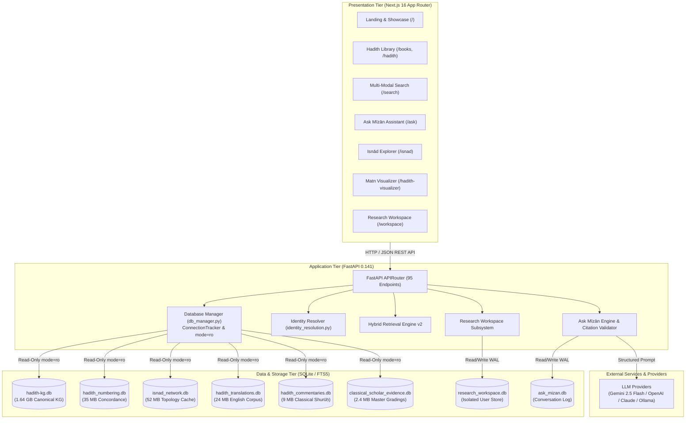

# MĪZĀN AL-ḤADĪTH (ميزان الحديث)

### Computational Hadith Platform · Topological Isnād Networks · Grounded Research Assistant · Concordance Crosswalks

[](LICENSE)
[](https://www.python.org/)
[](https://nextjs.org/)
[](https://fastapi.tiangolo.com/)
[](https://www.typescriptlang.org/)
[-green.svg)](docs/api/endpoint-reference.md)
[](docs/data/dataset-inventory.md)

---

## 🧭 Executive Summary

**Mīzān al-Ḥadīth** (ميزان الحديث — *"The Scale of Hadith"*) is an open-source, research-grade computational digital humanities platform engineered for the forensic study of classical Islamic Hadith literature.

It bridges fourteen centuries of traditional Islamic transmission sciences (*ʿIlm al-Ḥadīth*, *ʿIlm al-Rijāl*, *ʿIlm al-Jarḥ wa al-Taʿdīl*) with modern graph theory, lexical diffing, full-text search, and grounded retrieval-augmented generation (RAG).

```
       +-------------------------------------------------------------+
       |               CANONICAL HERITAGE PRESERVATION               |
       |  Immutable Primary Texts (715k) · Jarḥ wa Taʿdīl (127k)     |
       +------------------------------+------------------------------+
                                      |
                                      v
       +-------------------------------------------------------------+
       |              DETERMINISTIC RELATIONAL GRAPH                 |
       |  Isnād Network (298k Edges) · 18 Numbering Crosswalks (95k)  |
       +------------------------------+------------------------------+
                                      |
                                      v
       +-------------------------------------------------------------+
       |             VERIFIABLE HYBRID RETRIEVAL ENGINE              |
       |  Exact Match Routing + FTS5 Lexical BM25 + Semantic Rerank  |
       +------------------------------+------------------------------+
                                      |
                                      v
       +-------------------------------------------------------------+
       |               SCHOLARLY RESEARCH WORKSPACE                  |
       | Isolated Projects · Claim-Evidence Matrix · Dossier Exports |
       +-------------------------------------------------------------+
```

---

## ⚡ Quick Links & Documentation Portal

- 📊 **[Interactive Architecture & Graph Explorer](docs/index.html)** *(7 Interactive Visualizers, SVG Canvas, Node Inspector)*
- 📖 **[Documentation Portal Master Index](docs/index.md)**
- 🏗️ **[System Architecture](docs/architecture/system-overview.md)** · **[Frontend Guide](docs/architecture/frontend-architecture.md)** · **[Backend Guide](docs/architecture/backend-architecture.md)**
- ⚡ **[REST API Reference (95 Endpoints)](docs/api/endpoint-reference.md)**
- 📜 **[Dataset Provenance & Attribution Register](docs/data/provenance-and-attribution.md)**
- 🛡️ **[Security, Privacy & Scholarly Safeguards Audit](docs/github-publication/SECURITY_AND_PRIVACY_AUDIT.md)**
- 🧪 **[Automated Test Verification](docs/development/testing.md)**

---

## 📚 What Mīzān Does

1. **Canonical Six Books Library (*al-Kutub al-Sittah*):** Explores **715,790 hadith records** across 425 historical volumes, with verified Arabic mutūn, chapter boundaries, and **31,488 verified English translations**.
2. **Topological Isnād Network Analysis:** Transforms flat textual transmission chains into directed acyclic multigraphs (**298,655 transmission edges** across **49,844 transmitter nodes**), with 2D graph views, generational timelines (1–300 AH), 12-center historical Islamic geographical atlases, and 3D spatial orbit views.
3. **Multi-Edition Numbering Concordances:** Deterministically resolves references across **18 international print editions** (Darussalam, Fu'ad 'Abd al-Baqi, Ahmad Shakir, A.J. Wensinck), reconciling discrepancies between international English translations and classical Arabic printings across **95,598 mapping records**.
4. **Ask Mīzān Grounded AI Research Assistant:** Evidence-grounded natural language assistant constrained by strict anti-hallucination citation validation. If evidence is absent, it refuses to speculate; all citations are verified bit-for-bit against retrieved evidence packs.
5. **Matn Variant Diffing:** Side-by-side textual alignment computing token-level additions, deletions, and lexical similarity scores across parallel transmissions.
6. **Scholarly Research Workspace:** Isolated, multi-user research workbench for creating projects, bookmarking evidence, writing notes, and formulating claim-evidence matrices (supporting vs. challenging evidence) without altering canonical datasets.

---

## 🔍 Verified Feature Catalog

| Feature Module | Primary Purpose | Capabilities | Technical Stack | Status | Documentation |
| :--- | :--- | :--- | :--- | :--- | :--- |
| **Hadith Library** | Primary corpus navigation across the Six Canonical Compilations. | Book catalog, chapter indices, pagination, Arabic matn, English translation, isnād breakdown. | Next.js `/books`, `/hadith/[id]`; FastAPI `/api/hadith/{id}`. | **VERIFIED** | [Documentation](docs/features/hadith-library.md) |
| **Multi-Modal Search** | Instant cross-collection search. | Exact citation lookup, Arabic FTS5 search with orthographic normalization, English FTS5. | SQLite FTS5; FastAPI `/api/search`, `/api/numbering/resolve`. | **VERIFIED** | [Documentation](docs/features/search-and-retrieval.md) |
| **Ask Mīzān Assistant** | Grounded research dialogue. | Multi-turn chat, intent routing, evidence pack assembly, citation validation guard. | FastAPI `/api/ask`; Gemini 2.5 Flash / OpenAI adapter; validator. | **VERIFIED** | [Documentation](docs/features/ask-mizan.md) |
| **Narrator Research** | Biographical critique (*ʿIlm al-Rijāl*). | Transmitter dates, locations, 127k jarḥ wa taʿdīl statements, father/son collision guards. | Next.js `/narrators`, `/narrator/[id]`; FastAPI `/api/narrator/{id}`. | **VERIFIED** | [Documentation](docs/features/narrator-research.md) |
| **Isnād Explorer** | Computational transmission analysis. | 2D directed transmission graph, generational timeline, 12-center historical atlas, 3D space. | Next.js `/isnad`; precomputed `isnad_network.db` (298k edges). | **VERIFIED** | [Documentation](docs/features/isnad-explorer.md) |
| **Matn Variant Diff** | Comparative textual criticism. | Side-by-side view, token-level additions/deletions, lexical similarity score. | Next.js `/hadith-visualizer`; `MatnDiffViewer.tsx`; FastAPI diff engine. | **VERIFIED** | [Documentation](docs/features/matn-analysis.md) |
| **Classical Commentary** | Historical interpretation (*Shurūḥ*). | Excerpts from *Fatḥ al-Bārī*, *Sharḥ Ṣaḥīḥ Muslim*, *ʿAwn al-Maʿbūd*, volume/page citations. | `HadithCommentarySection.tsx`; FastAPI `/api/hadith/{id}/commentaries`. | **VERIFIED** | [Documentation](docs/features/commentary-system.md) |
| **Numbering Crosswalk** | Cross-edition concordance. | Mapping across Darussalam, Fu'ad 'Abd al-Baqi, and Wensinck numbering across 95k records. | `hadith_numbering.db`; FastAPI `/api/numbering/resolve`. | **VERIFIED** | [Documentation](docs/features/numbering-and-crosswalks.md) |
| **Scholarly Evidence** | Multi-scholar grading matrix. | Classical master evaluations (al-Tirmidhi, al-Bukhari) + modern verifications (Zubair Ali Zai). | `classical_scholar_evidence.db`; FastAPI `/api/hadith/{id}/grades`. | **VERIFIED** | [Documentation](docs/features/scholarly-evidence.md) |
| **Research Workspace** | Private scholarly workbench. | Project creation, evidence bookmarks, notes, claim-evidence matrix, dossier export. | Next.js `/workspace`; FastAPI `/api/workspace/*`; isolated WAL store. | **VERIFIED** | [Documentation](docs/features/research-workspace.md) |
| **Citation & Export** | Academic publication formatting. | Chicago Manual of Style & classical Arabic citations; Markdown & JSON dossier exports. | `research_workspace.py`; `CitationChip.tsx`; export endpoints. | **VERIFIED** | [Documentation](docs/features/citation-and-export.md) |

---

## 🏛️ System Architecture



---

## 🛠️ Technology Stack

| Layer | Technology | Version | Purpose in Mīzān | Verification Evidence |
| :--- | :--- | :--- | :--- | :--- |
| **Frontend Framework** | Next.js | `16.3.6` | App Router, React Server Components & Static Site Generation | `mizan-web/frontend/package.json` |
| **UI Library** | React & React DOM | `19.2.8` | Component rendering engine & reactive UI | `mizan-web/frontend/package.json` |
| **Styling Engine** | Tailwind CSS | `4.0.x` | Design system tokens and utility CSS styling | `mizan-web/frontend/package.json` |
| **Iconography** | Lucide React | `1.47.0` | Accessible vector iconography suite | `mizan-web/frontend/package.json` |
| **Type Checking** | TypeScript | `5.x` | Static typing (`npx tsc --noEmit` verified clean) | `mizan-web/frontend/tsconfig.json` |
| **Backend Framework** | FastAPI | `0.141.1` | High-performance asynchronous REST microservice | Python runtime inspect |
| **ASGI Server** | Uvicorn | `0.53.0` | Production asynchronous ASGI server | Python runtime inspect |
| **Data Validation** | Pydantic | `2.13.5` | Strict request/response schema parsing | Python runtime inspect |
| **Database Engine** | SQLite3 | `3.45+` | Embedded relational storage with WAL & FTS5 | Python standard library |
| **AI LLM SDK** | Google GenAI | `2.23.0` | Grounded inference via Gemini 2.5 Flash | Python runtime inspect |

---

## 📊 Dataset & Canonical Knowledge Graph Inventory

Every database asset is forensically verified with exact sizes and table record counts:

| Database File | File Size | Table Record Counts (Empirically Verified) | Scholarly Role |
| :--- | :--- | :--- | :--- |
| `data/hadith-kg.db` | **1.64 GB** | `hadiths`: 715,790 · `rawis`: 49,844 · `sanads`: 577,024 · `sanad_rawis`: 4,414,211 · `books`: 425 · `aqwal`: 127,863 · `alems`: 1,015 | Canonical Primary Texts, Transmission Chains & Biographical Dictionary |
| `data/hadith_numbering.db` | **35.09 MB** | `hadith_numbers`: 95,598 · `numbering_provenance`: 95,598 · `numbering_editions`: 18 · `numbering_authorities`: 4 | Multi-Edition Concordance Crosswalks (Darussalam, Fu'ad 'Abd al-Baqi, Wensinck) |
| `data/isnad_network.db` | **52.09 MB** | `narrator_nodes`: 49,844 · `narrator_edges`: 298,655 · `network_meta`: 7 | Precomputed Directed Transmission Graph Cache |
| `data/hadith_translations.db` | **24.05 MB** | `hadith_translations`: 31,488 | Parallel English Translation Corpus |
| `data/hadith_commentaries.db` | **9.05 MB** | `hadith_commentaries`: 1,202 · `commentary_hadith_links`: 1,203 · `commentary_sources`: 8 | Classical Commentary Corpus (*Fatḥ al-Bārī*, *Sharḥ Ṣaḥīḥ Muslim*, etc.) |
| `data/citation_enrichment.db`| **9.25 MB** | `zubair_grade_references_v3`: 14,398 | Modern Takhrij References & Analytical Gradings |
| `data/classical_scholar_evidence.db`| **2.43 MB**| `classical_hadith_evaluations`: 3,462 · `classical_scholars`: 3 | Classical Author Judgments (al-Tirmidhi, al-Bukhari, Ibn Hajar) |
| `data/ask_mizan.db` | **37.26 MB** | `conversations`: 780 · `messages`: 1,542 · `citations`: 4,200 · `feedback`: 21 | Additive Research Log, Multi-Turn Threads & User Ratings |

---

## 🚀 Getting Started & Local Setup

### 1. Prerequisites
- **Python:** `3.11+`
- **Node.js:** `20.x` or `22.x LTS`
- **Git:** `2.40+`

### 2. Clone & Configure Environment
```bash
git clone https://github.com/<owner>/mizan-al-hadith.git
cd mizan-al-hadith

# Copy environment templates
cp .env.example .env
cp mizan-web/frontend/.env.example mizan-web/frontend/.env.local
```

### 3. Backend Setup
```bash
cd mizan-web/backend
python -m venv .venv

# On Windows (PowerShell):
.\.venv\Scripts\Activate.ps1
# On macOS / Linux:
source .venv/bin/activate

pip install -r requirements.txt
uvicorn main:app --reload --port 8000
```
Backend API will be live at: `http://127.0.0.1:8000`  
Swagger UI: `http://127.0.0.1:8000/docs`

### 4. Frontend Setup
In a separate terminal:
```bash
cd mizan-web/frontend
npm install
npm run dev
```
Web application will be accessible at: `http://localhost:3000`

---

## 🧪 Automated Testing & Verification

All automated regression test suites are verified and ready for execution:

```bash
# 1. Research Workspace Subsystem Suite (15/15 passed)
python scripts/test_workspace_backend.py

# 2. Scholarly Integrity & Collision Guards (10/10 passed)
python scripts/test_scholarly_integrity.py

# 3. Ask Mīzān Grounded Pipeline Suite (18/18 passed)
python scripts/test_ask_mizan_suite.py

# 4. Critical Fixes Sprint Suite (11/11 passed)
python scripts/test_critical_fixes_sprint.py

# 5. Frontend TypeScript Typecheck (0 errors)
cd mizan-web/frontend && npx tsc --noEmit
```

---

## 🛡️ Scholarly Safeguards & Methodological Invariants

1. **Strict Immutability of Canonical Data:** Primary texts and classical judgments connect via SQLite URI `mode=ro` (read-only). Runtime mutations (`INSERT`, `UPDATE`, `DELETE`) are strictly prohibited and immediately blocked.
2. **Father/Son & Similar-Name Collision Guards:** Identifies ambiguity in similar-named transmitters (e.g. Abdur Rahman al-Musalli vs. his son Wabarah) and displays explicit `father_son_collision` alerts.
3. **Citation Anti-Hallucination Guard:** Every statement generated by Ask Mīzān must be cited against authentic evidence packs. Any ungrounded tokens are automatically stripped or flagged.
4. **Scholarly Tier Demarcation:** Clearly separates historical author evaluations from modern editorial opinions and researcher hypotheses.

---

## 📜 Dataset Provenance & Attribution

Mīzān al-Ḥadīth combines canonical classical literature with modern computational knowledge graphs, multi-scholar authenticity gradings, and academic concordances. The project adheres to strict academic attribution:

1. **Primary Hadith Knowledge Graph:** Compiled and relationalized by **Emaad Jumaah (Emad Jumaah)** ([GitHub](https://github.com/emadjumaah/hadith) · [Hugging Face](https://huggingface.co/datasets/emadjumaah/hadith-kg)), licensed under **CC-BY-4.0**. Original classical texts (*mutūn* and *asānīd*) composed by historical authors reside in the universal Public Domain.
2. **HadithPro Authenticity Gradings:** Multi-scholar evaluations (65,420 records) sourced from the **HadithPro Project** ([GitHub](https://github.com/unkn4wn/hadith-pro)), preserving explicit scholar attributions (Ḥāfiẓ Zubair ʿAlī Zaʾī, Shaykh al-Albānī, Shaykh Shuʿayb al-Arnāʾūṭ, and others).
3. **Classical Commentary Corpus:** Excerpts from 8 classical works across two verified digital traditions:
   - Six works (*Fatḥ al-Bārī*, *al-Minhāj Sharḥ Ṣaḥīḥ Muslim*, *Tuḥfat al-Aḥwadhī*, *ʿAwn al-Maʿbūd*, and *Ḥāshiyat al-Sindī* on Nasāʾī and Ibn Mājah) digitized via Muhammad Hashim's **Open-Hadith-Data** ([GitHub](https://github.com/mhashim6/Open-Hadith-Data)), licensed under **ODbL 1.0** (classical texts: Public Domain).
   - Two works (*ʿUmdat al-Qārī* and *Irshād al-Sārī*) sourced via **Al-Maktaba al-Shamela** ([shamela.ws](https://shamela.ws)).
4. **English Translation Corpus:** 31,488 academic translations aligned via the **Sunnah.com Open Hadith Project** ([sunnah.com](https://sunnah.com)). Modern publisher translations (Darussalam, etc.) are utilized strictly under **Academic & Educational Fair Use**; commercial redistribution is restricted.
5. **Multi-Edition Numbering & Concordance:** 95,598 mappings across 18 publication schemes, standardizing references from al-Maktabah al-Shāmilah, Darussalam, Sunnah.com, and Fu'ād ʿAbd al-Bāqī.
6. **Itqan Narrator Database:** 49,844 scholarly transliterations, 128k name variants, and 91k narrator grades compiled by **Ali Bin Shahid** ([GitHub](https://github.com/r3genesi5/Itqan) · [DOI 10.5281/zenodo.19453612](https://doi.org/10.5281/zenodo.19453612)).
7. **Classical Scholar Evidence:** 3,462 frozen authorial evaluations directly recorded in the classical corpora of Imam al-Tirmidhī, Imam Abū Dāwūd, and Imam al-Nasāʾī.
8. **Historical Geographic Gazetteer:** Transmission hubs and coordinates mapped from Yāqūt al-Ḥamawī (*Muʿjam al-Buldān*) and classical biographical demographics.

📖 **Detailed Registers & Governance Documentation:**
- 📋 **[Complete Forensic Dataset Inventory](docs/data/dataset-inventory.md)** — Exhaustive 13-column schema with record counts, transformations, and licenses.
- 🏛️ **[Dedicated Provenance & Attribution Register](docs/data/provenance-and-attribution.md)** — Detailed 14-section source lineage and methodological guarantees.
- 🌐 **[External APIs & Hosted Services Register](docs/data/external-services.md)** — Google Gemini, OpenAI, Anthropic, and Ollama offline runtime specifications.
- ⚖️ **[Licensing & Redistribution Directive](docs/data/licensing-and-redistribution.md)** — Full IP audit and redistribution constraints matrix.

---

## 📄 License & Intellectual Property

- **Software Codebase:** Licensed under the [MIT License](LICENSE).
- **Primary Hadith Mutūn & Asānīd:** Public Domain (Universal Cultural Heritage).
- **Translations & Commentaries:** Academic & Educational Fair Use.

---

*Mīzān al-Ḥadīth (ميزان الحديث) — Preserving Classical Islamic Heritage with Modern Computational Rigor.*
