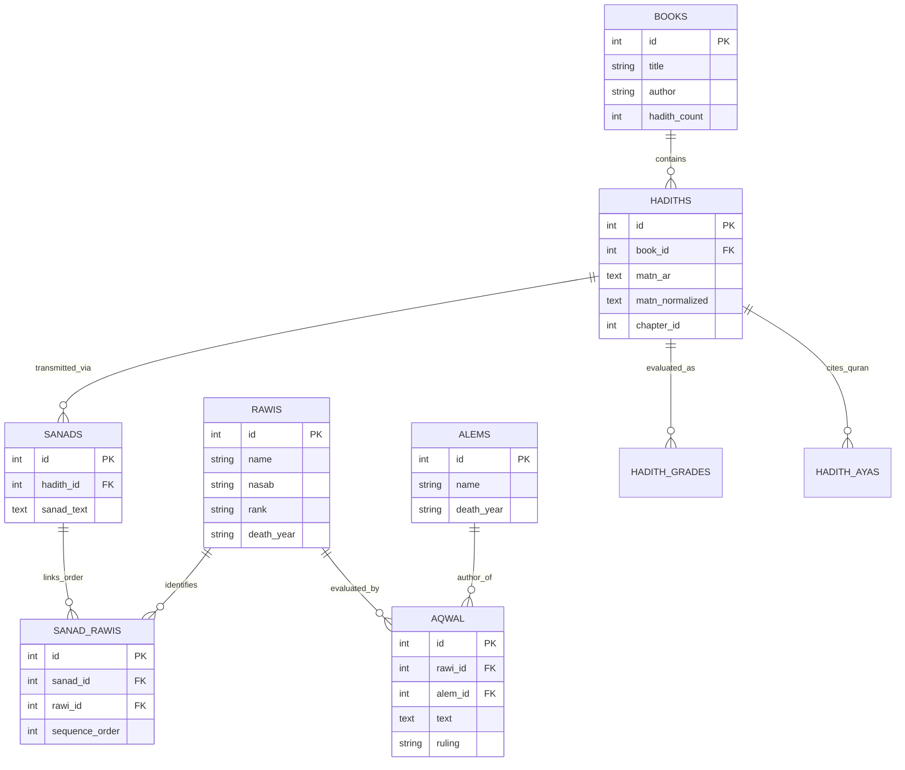

# MĪZĀN AL-ḤADĪTH — DATA ARCHITECTURE & SCHEMAS

**Document Identifier:** `docs/architecture/data-architecture.md`  
**System Baseline:** Verified Database Schemas & Record Counts  

---

## 1. Relational Topology & Physical Databases

The Mīzān platform divides its state across discrete, purpose-specific SQLite relational databases:

```
+-----------------------------------------------------------------------------------------+
|                                DATA ARCHITECTURE MAP                                    |
+-----------------------------------------------------------------------------------------+
|  CANONICAL IMMUTABLE LAYER (mode=ro)                                                    |
|  ├── hadith-kg.db                 Primary text corpus, narrators, sanads (1.64 GB)      |
|  ├── hadith_numbering.db          18-edition numbering crosswalks (35.09 MB)             |
|  ├── isnad_network.db             Precomputed topology graph cache (52.09 MB)           |
|  ├── hadith_translations.db       Parallel English translations (24.05 MB)              |
|  ├── hadith_commentaries.db       Classical historical commentaries (9.05 MB)           |
|  ├── classical_scholar_evidence.db Classical master evaluations (2.43 MB)               |
|  └── citation_enrichment.db       Modern takhrij & verification references (9.25 MB)    |
+-----------------------------------------------------------------------------------------+
|  INDEX & CACHE LAYER                                                                    |
|  ├── hadith-search-index.db       FTS5 Arabic search index (237 MB)                     |
|  ├── english_translation_fts.db   FTS5 English search index (31 MB)                     |
|  └── derived_embeddinggemma2_768d.db Experimental semantic vector embeddings (0.02 MB) |
+-----------------------------------------------------------------------------------------+
|  MUTABLE USER & APPLICATION LAYER (WAL mode)                                            |
|  ├── ask_mizan.db                 Multi-turn chat threads & citation logs (37.26 MB)    |
|  └── research_workspace.db        Isolated researcher projects, notes & claims          |
+-----------------------------------------------------------------------------------------+
```

---

## 2. Key Canonical Entity Relationships (`hadith-kg.db`)

The primary Hadith Knowledge Graph links classical books, narrations, transmission chains, and biographical transmitters:



---

## 3. Isnād Network Topology Model (`isnad_network.db`)

The isnād graph cache compiles the 4.4M `sanad_rawi` sequence steps into a consolidated directed multigraph:
- **`narrator_nodes` (49,844 records):**
  - `node_id` (INTEGER PK, matches canonical `rawi_id`)
  - `name_ar` (TEXT)
  - `name_translit` (TEXT)
  - `death_year_ah` (INTEGER)
  - `in_degree` (INTEGER: number of students who received narrations from this transmitter)
  - `out_degree` (INTEGER: number of teachers from whom this transmitter heard narrations)
  - `generation_tier` (INTEGER: 1 = Sahaba, 2 = Senior Tabi'in, 3 = Intermediate Tabi'in, etc.)
  - `canonical_center` (TEXT: Madinah, Kufa, Basra, Damascus, Cairo, etc.)
- **`narrator_edges` (298,655 records):**
  - `source_id` (INTEGER FK -> teacher `node_id`)
  - `target_id` (INTEGER FK -> student `node_id`)
  - `weight` (INTEGER: number of documented canonical asānīd containing this direct transmission)
  - `book_mask` (INTEGER: bitmask indicating in which canonical collections this edge occurs)

---

## 4. Numbering Crosswalk Concordance Model (`hadith_numbering.db`)

To ensure deterministic resolution across worldwide printed and digital editions:
- **`numbering_editions` (18 records):**
  - `edition_id` (INTEGER PK)
  - `edition_code` (TEXT: `bukhari_darussalam_en`, `muslim_abdul_baqi`, `nasai_darussalam`, etc.)
  - `authority_name` (TEXT: Darussalam, Fu'ad 'Abd al-Baqi, A.J. Wensinck, etc.)
- **`hadith_numbers` (95,598 records):**
  - `id` (INTEGER PK)
  - `canonical_hadith_id` (INTEGER FK -> `hadith-kg.db:hadiths.id`)
  - `edition_id` (INTEGER FK -> `numbering_editions.edition_id`)
  - `in_book_number` (TEXT)
  - `volume_number` (INTEGER)
  - `page_number` (INTEGER)
  - `normalized_lookup_key` (TEXT: indexed for sub-millisecond lookup)
