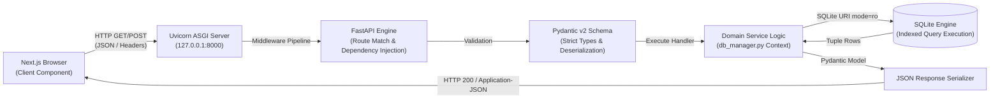

# MĪZĀN AL-ḤADĪTH — REQUEST LIFECYCLE & EXECUTION FLOW

**Document Identifier:** `docs/architecture/request-lifecycle.md`  
**System Baseline:** FastAPI 0.141 Application Lifecycle  

---

## 1. End-to-End Request Pipeline

Every HTTP request to Mīzān al-Ḥadīth flows through a deterministic, observable lifecycle from browser interaction to database execution and response serialization.

---

## 2. Request Handling Phases

### Phase 1: Client Request Ingestion
- Client components in `mizan-web/frontend` initiate an asynchronous `fetch()` call.
- Standard headers are appended:
  - `Content-Type: application/json`
  - `Accept: application/json`
  - `X-Researcher-Id: <user_id>` (for `/api/workspace/*` operations)

### Phase 2: ASGI Routing & Middleware
- Uvicorn receives the socket connection and passes the ASGI scope to FastAPI.
- CORS middleware inspects `Origin` against allowed hosts.
- Global timing and error-handling middleware intercepts unhandled exceptions, returning structured RFC 7807 JSON errors.

### Phase 3: Pydantic Validation & Dependency Injection
- Request body and query parameters are validated against Pydantic models.
- If invalid (e.g. negative hadith ID or missing query string), an immediate `422 Unprocessable Entity` is returned with parameter-level error descriptions.
- Dependencies (such as `get_current_user_id`) resolve authentication headers.

### Phase 4: Database Execution under Context Manager
- Domain services invoke `open_readonly_connection(DB_PATH)`.
- The connection is registered with `ConnectionTracker`.
- Queries execute over indexed B-trees or FTS5 virtual tables.
- Rows are mapped to domain objects.
- In `finally:` blocks or context exit, `conn.close()` is guaranteed, deregistering the handle from `ConnectionTracker`.

### Phase 5: Response Serialization & Streaming
- Domain objects serialize to standard JSON dictionaries.
- For Ask Mīzān streaming endpoints (`/api/ask/stream`), an ASGI `StreamingResponse` yields Server-Sent Events (SSE) token by token.
