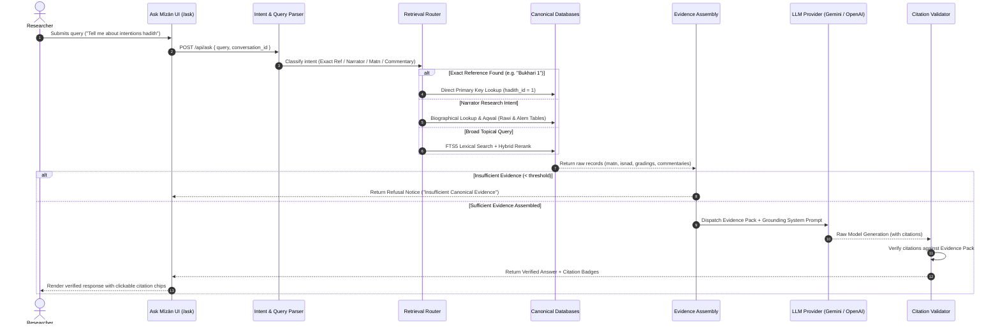

# MĪZĀN AL-ḤADĪTH — RETRIEVAL & ASK MĪZĀN PIPELINE

**Document Identifier:** `docs/architecture/retrieval-and-rag.md`  
**Subsystem Directory:** `mizan-web/backend/ask_mizan`  
**Architecture:** Grounded RAG with Deterministic Citation Guard  

---

## 1. Grounded Synthesis Architecture

Ask Mīzān ("اسأل ميزان") is an evidence-grounded research assistant that enables scholars to query the Hadith corpus using natural language.

Unlike generic conversational chatbots that predict text based on pretraining weights alone, Ask Mīzān enforces a **Strict Grounding Contract**:
1. It does not answer until an authentic evidence pack is assembled from the canonical databases.
2. If no matching hadith or biographical record is found, it **confidently refuses** to speculate and issues a structured insufficient-evidence notice.
3. Every factual statement generated by the model must cite a canonical Hadith ID (`[Bukhari #1]`, `[Muslim #1907]`, `[Rawi #4396]`).
4. A post-generation citation validation engine strips or flags any statement that references a non-existent or unprovided hadith.

---

## 2. Multi-Stage Pipeline Execution

---

## 3. Query Intent Routing (`parser.py`)

The query parser extracts entities and classifies user intent before querying the database:
- **`EXACT_HADITH`:** Matches pattern `[Collection] [Number]` (e.g. `Sahih al-Bukhari 1`, `Sunan an-Nasa'i 348`, `Ibn Majah 1986`). Bypasses fuzzy search and directly queries the crosswalk concordance table.
- **`NARRATOR_RESEARCH`:** Matches queries asking about individuals (e.g., `Who was Sufyan al-Thawri?`, `Jarh on Abdur Rahman al-Musalli`). Routes directly to `rawis` and `aqwal` tables without injecting unrelated hadiths into the prompt.
- **`COMMENTARY_RESEARCH`:** Matches inquiries asking for classical explanations (e.g., `What does Fath al-Bari say about hadith 1?`). Routes directly to `hadith_commentaries.db`.
- **`MATN_COMPARISON`:** Matches comparative queries (e.g., `Compare Bukhari 1 and Muslim 1907`). Retrieves both narrations and computes lexical alignment metrics.
- **`TOPICAL_SEARCH`:** Fallback for thematic queries. Dispatches to SQLite FTS5 search.

---

## 4. Citation Anti-Hallucination Guard (`validator.py`)

The post-generation validator acts as an automated peer reviewer:
1. **Extraction:** Parses all citation markers matching `\[([A-Za-z\s]+)#?(\d+)\]` or `\[Rawi #?(\d+)\]`.
2. **Set Intersection:** Compares extracted references against the exact set of canonical IDs present in the input evidence pack.
3. **Purge / Flag:** If the model hallucinates a reference not present in the evidence pack, the validator:
   - Purges the false reference or appends an explicit warning badge (`[UNVERIFIED CITATION]`).
   - Flags the response in `ask_mizan.db` for automated review.
