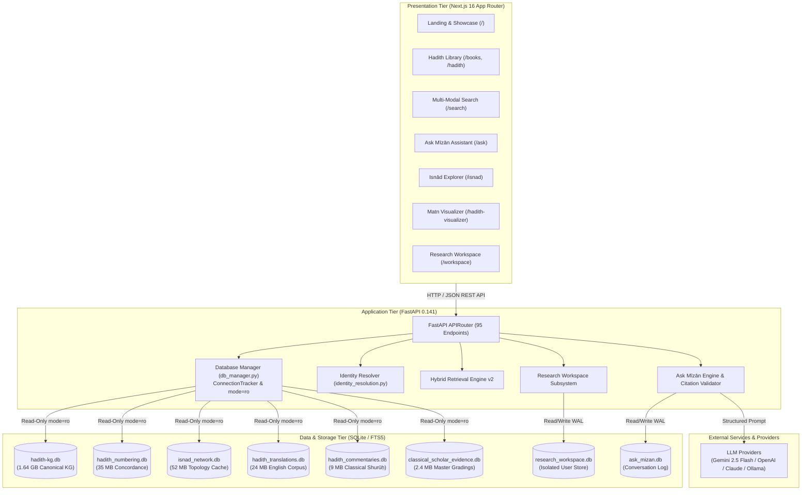

# MĪZĀN AL-ḤADĪTH — SYSTEM ARCHITECTURE OVERVIEW

**Document Identifier:** `docs/architecture/system-overview.md`  
**System Baseline:** Production Relational Graph & Hybrid Retrieval v2  

---

## 1. High-Level Architectural Topology

Mīzān al-Ḥadīth is architected as a modular, decoupled full-stack platform comprising:
1. **Frontend Presentation Tier:** Next.js 16 (App Router) executing on Node.js 20+, providing responsive, accessible interfaces for library reading, isnād graph visualization, matn comparison, and research workspace management.
2. **Backend Application Tier:** FastAPI 0.141+ asynchronous microservice providing 95 REST API endpoints, routing logic, identity resolution, and query synthesis.
3. **Data & Storage Tier:** High-performance local SQLite relational databases with WAL concurrency, FTS5 full-text indexing, and precalculated isnād topology caches.
4. **Retrieval & AI Synthesis Tier:** Multi-tier hybrid retrieval (exact concordance routing + lexical BM25 + semantic reranking) coupled with provider-agnostic LLM synthesis and deterministic citation anti-hallucination validation.

---

## 2. Subsystem Decomposition & Boundaries

### 2.1 Decoupled Client-Server Communication
- The Next.js frontend communicates with the backend exclusively via standard HTTP/JSON requests over `NEXT_PUBLIC_API_URL` (default: `http://127.0.0.1:8000/api`).
- No direct database drivers, native bindings, or binary file handles exist in the frontend bundle. This guarantees that the web client can be deployed independently (e.g., to Vercel, Cloudflare, or Docker) with zero architectural changes.

### 2.2 Strict Database Isolation Invariant
- **Canonical Layer:** `hadith-kg.db`, `hadith_numbering.db`, `isnad_network.db`, `hadith_translations.db`, `hadith_commentaries.db`, and `classical_scholar_evidence.db` are **strictly read-only** across all operations.
- **Mutable Layer:** User-generated content is restricted to two isolated files:
  - `data/ask_mizan.db`: Multi-turn chat session history and feedback logging.
  - `data/research_workspace.db`: Projects, notes, claims, and evidence bookmarks.

---

## 3. Technology Stack Reference Table

| Architectural Layer | Component | Version / Standard | Verified Role | Source Evidence |
| :--- | :--- | :--- | :--- | :--- |
| **Frontend Framework** | Next.js | `16.3.6` | App Router, Server Components & Static Optimization | `mizan-web/frontend/package.json` |
| **UI Library** | React & React DOM | `19.2.8` | Component rendering and reactive state | `mizan-web/frontend/package.json` |
| **CSS Engine** | Tailwind CSS | `4.0.x` | Utility styling and responsive design tokens | `mizan-web/frontend/package.json` |
| **Iconography** | Lucide React | `1.47.0` | Accessible SVG vector iconography suite | `mizan-web/frontend/package.json` |
| **Type System** | TypeScript | `5.x` | Static typing and interface contracts | `mizan-web/frontend/tsconfig.json` |
| **Backend Framework** | FastAPI | `0.141.1` | High-performance asynchronous REST API | `mizan-web/backend/requirements.full-backup.txt` |
| **ASGI Server** | Uvicorn | `0.53.0` | Asynchronous production server | Python runtime inspect |
| **Data Validation** | Pydantic | `2.13.5` | Request parsing and strict schema enforcement | Python runtime inspect |
| **Database Engine** | SQLite3 | `3.45+` | Embedded zero-config relational storage with WAL & FTS5 | Python stdlib `sqlite3` |
| **AI LLM API** | Google GenAI SDK | `2.23.0` | Grounded inference via Gemini 2.5 Flash | Python runtime inspect |
