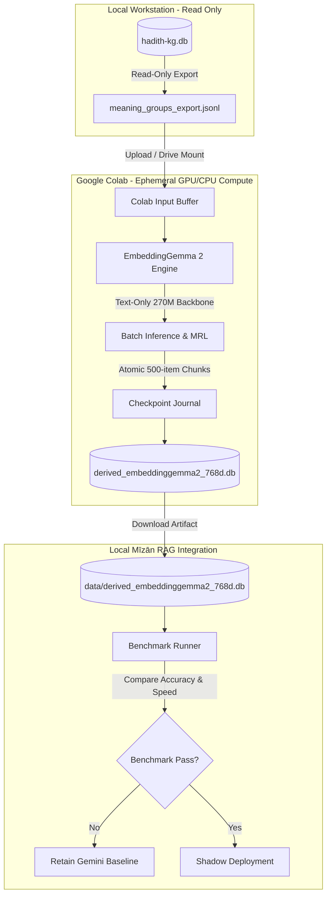
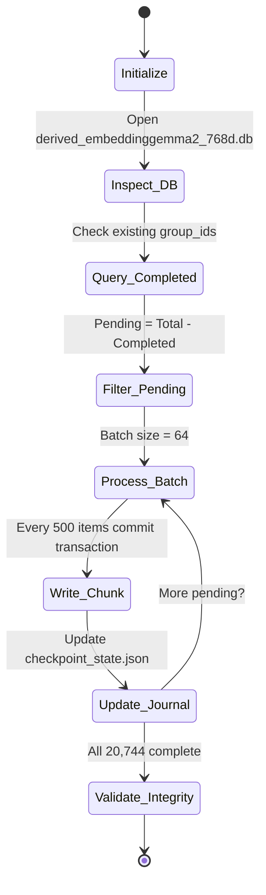
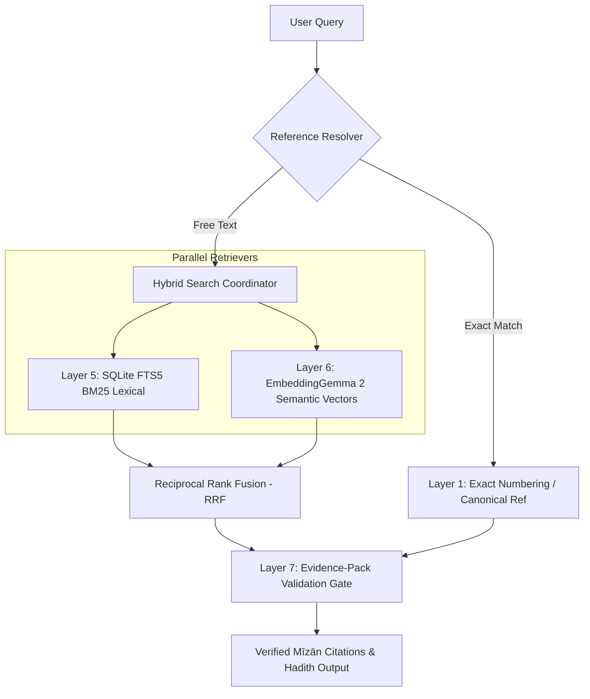
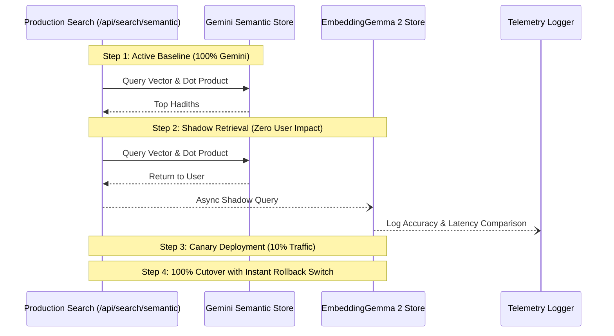

# MĪZĀN AL-HADĪTH — EMBEDDINGGEMMA 2 + GOOGLE COLAB PIPELINE
## Technical Audit, Architectural Specification & Production Implementation Plan
### Document Status: Phase 1 Specification (Planning Only — Zero Implementation Code Executed)
### Target System: Mīzān al-Ḥadīth (`discord-hadith-bot` / `mizan-web`)
### Date: October 2026

---

## 1. Executive Summary

This engineering specification establishes a safe, reproducible, and non-destructive plan for introducing **Google EmbeddingGemma 2** into **Mīzān al-Ḥadīth** as an alternative/experimental semantic retrieval engine alongside the existing baseline (`gemini-embedding-001`). 

### Core Architectural Principles
1. **Zero Mutation of Canonical Assets**: The primary relational knowledge graph `data/hadith-kg.db` (~1.64 GB, 715,790 hadiths) and its internal tables remain strictly read-only and immutable. No schema changes, no row deletions, and no in-place vector overwrites are permitted.
2. **Derived Storage Separation**: All EmbeddingGemma 2 vectors and experimental indices will reside in an isolated derived SQLite database (`data/derived_embeddinggemma2_768d.db`), preserving complete reversibility and zero operational risk to the production application.
3. **Decoupled Heavy Compute via Google Colab**: All offline corpus vector generation for the ~20,744 canonical meaning groups will execute exclusively on Google Colab (leveraging free/Pro GPU runtimes such as T4 or A100, with robust CPU fallback). The developer's local workstation will run zero heavy batch neural network training or corpus embedding jobs.
4. **Resilience & Resumability**: The Colab embedding pipeline features an atomic chunked checkpointing architecture, allowing seamless resumption following session timeouts, GPU preemptions, or network disconnections without data duplication or corpus re-runs.
5. **Rigorous Benchmark Gate**: Existing Gemini embeddings (`gemini-embedding-001`) serve as the authoritative baseline. Production migration will occur if and only if EmbeddingGemma 2 demonstrates statistically significant retrieval quality gains on an objective, multilingual, hadith-specific benchmark suite spanning Arabic, Urdu, English, and canonical citation patterns.

---

## 2. Current Mīzān Architecture Audit

A comprehensive code and database audit of the active repository was conducted. The following components and configurations define the system topology:

### 2.1 Repository Topology
```text
discord-hadith-bot/
├── data/                               # Local SQLite data repository
│   ├── hadith-kg.db                   # Canonical Knowledge Graph (1.64 GB, READ-ONLY)
│   ├── derived_semantic_index.db      # Derived Gemini Semantic Vectors (85 MB, Rebuildable)
│   ├── hadith_translations.db         # Verified multi-lingual translations (24 MB)
│   ├── english_enrichment.db          # Transliterations, themes & metadata (52 MB)
│   ├── english_translation_fts.db     # English FTS5 lexical index (32.8 MB)
│   ├── hadith-search-index.db         # Arabic FTS search index (248 MB)
│   ├── isnad_network.db               # Narrator transmission graphs (52 MB)
│   ├── hadith_numbering.db            # Canonical crosswalk & editions (35 MB)
│   ├── hadith_commentaries.db         # Classical scholarly sharḥ (9 MB)
│   ├── citation_enrichment.db         # Scholarly citation tags (9.2 MB)
│   ├── ask_mizan.db                   # Interaction logs & chat turns (9.4 MB)
│   └── _iu_mapping_search.db          # IslamicUrdu mapping index (706 MB)
├── mizan-web/
│   ├── backend/                       # Python FastAPI Application
│   │   ├── main.py                    # Core routing & API endpoints (5,214 lines)
│   │   ├── db_manager.py              # Centralized connection manager (P0-01)
│   │   ├── identity_resolution.py     # Canonical narrator identity resolution
│   │   ├── sanad_aligner.py           # Narrator chain alignment
│   │   ├── scholarly_service.py       # Grades & classical evaluations
│   │   ├── reference_resolver.py      # Multi-scheme reference parsing
│   │   ├── ask_mizan/                 # Ask Mīzān RAG engine
│   │   │   ├── engine.py              # Pipeline coordinator
│   │   │   ├── semantic.py            # Vector search & Gemini API integration
│   │   │   ├── tools.py               # Deterministic retrieval tools
│   │   │   ├── validator.py           # Evidence-pack verification
│   │   │   └── providers/             # LLM provider factory (Gemini, OpenAI, etc.)
│   │   ├── Dockerfile                 # Container packaging specification
│   │   └── requirements.txt           # Lean dependencies (fastapi, uvicorn, requests)
│   └── frontend/                      # Next.js 16 (React 19) Application
│       ├── src/app/search/            # Arabic/English Lexical Search UI
│       └── src/app/ask/               # Ask Mīzān Research Interface
└── src/                               # Discord bot & shared CLI services
    └── hadith_service.py              # Core CLI retrieval & matching service
```

### 2.2 Database Handle & Lifecycle Management (`mizan-web/backend/db_manager.py`)
Mīzān enforces strict architectural safeguards via `db_manager.py`:
- **Read-Only Engine Gate**: `open_readonly_connection()` connects via SQLite URI `file:<path>?mode=ro` and executes `PRAGMA query_only = ON;`.
- **WAL Invariant**: WAL mode is explicitly disabled on canonical immutable databases to prevent file mutation and sidecar locks, while enabled only on isolated application databases (`ask_mizan.db`, `user_annotations.db`).
- **Telemetry & Connection Tracking**: All handles are registered in a thread-safe `ConnectionTracker` ensuring deterministic connection cleanup and zero connection leaks.

### 2.3 Existing Retrieval Subsystems
The system implements a multi-tiered fallback retrieval pipeline:
1. **Layer 1: Exact Reference Lookup** (`parse_external_reference_query` & `resolve_numbering_record`): Resolves standard citations (e.g., `Bukhari 1`, `Muslim 1907`, `Tirmidhi 2861`) through `hadith_numbering.db`.
2. **Layer 2: Exact Identifier Lookup**: Direct lookup by canonical primary key `hadiths.id`.
3. **Layer 3: Crosswalk Resolution**: Edition-specific mapping across Darussalam, In-Book, and Chapter numbering.
4. **Layer 4 & 5: Lexical & Normalized FTS5 Retrieval**:
   - Arabic: Candidate generation via `perform_hadith_search()` using normalized token intersection across `taraf_nass` and `matn`.
   - English: Full-text search via `english_translation_fts.db` over `english_fts` FTS5 table with query sanitization and stopword filtering.
5. **Layer 6: Semantic Vector Retrieval** (`ask_mizan/semantic.py`): In-memory dot-product cosine similarity over 20,744 precomputed meaning-group vectors.
6. **Layer 7: Strict Evidence-Pack Construction**: Verification gate ensuring zero LLM hallucination and 100% citation binding.

---

## 3. Audit of the Existing Embedding System

### 3.1 Verification of `hadith-kg.db` -> `group_embedding`
Direct empirical inspection of the canonical database revealed the following verified facts:

| Property | Verified Value | Inspection Source |
| :--- | :--- | :--- |
| **Table Name** | `group_embedding` | `sqlite_master` in `data/hadith-kg.db` |
| **Schema** | `CREATE TABLE group_embedding (group_id INTEGER NOT NULL, model TEXT NOT NULL, dim INTEGER NOT NULL, vector BLOB NOT NULL, PRIMARY KEY (group_id, model, dim))` | `sqlite_master` schema definition |
| **Row Count** | **20,744** | `SELECT count(*) FROM group_embedding;` |
| **Model String** | `gemini-embedding-001` | `SELECT DISTINCT model FROM group_embedding;` |
| **Dimension** | **768** | `SELECT DISTINCT dim FROM group_embedding;` |
| **BLOB Size** | **3,072 bytes** (768 × 4 bytes Float32) | `SELECT length(vector) FROM group_embedding LIMIT 1;` |
| **Binary Format** | IEEE 754 32-bit float, little-endian | `np.frombuffer(blob, dtype=np.float32)` |
| **Stored Vector Norm** | Raw API output (L2 norm ≈ 0.58, unnormalized) | Computed via `np.linalg.norm(arr)` |
| **Relationship to Meaning Groups** | 1-to-1 match for all active groups (`id > 0`) | `meaning_groups.id` 1 to 22,321 |

### 3.2 Canonical Meaning Groups (`meaning_groups`)
- **Total Rows**: 20,745 rows (`id` ranging from 0 to 22,321).
- **Placeholder Row**: `id = 0` contains `nass = 'غير منشور'` (unreleased placeholder; excluded from embeddings).
- **Active Groups Embedded**: Exactly **20,744** groups have `id > 0` and non-empty `nass`.
- **Text Embedded**: The original generation script (`hadith/js/scripts/embed-groups.mjs`) embedded `meaning_groups.nass` with API parameter `taskType: "RETRIEVAL_DOCUMENT"`.
- **Meaning Group Schema**:
  ```sql
  CREATE TABLE meaning_groups (
    id INTEGER PRIMARY KEY,
    taraf_id INTEGER,
    is_qudsi INTEGER NOT NULL,
    matn_no INTEGER NOT NULL,
    sahaba_qty INTEGER NOT NULL,
    repeat_qty INTEGER NOT NULL,
    nass TEXT NOT NULL
  );
  ```

### 3.3 Mapping from Meaning Groups Back to Hadiths
The canonical relational knowledge graph links narrations to meaning groups via `hadiths.group_id`:
- **Total Hadiths**: 715,790 narrations in `data/hadith-kg.db`.
- **Hadiths with Group Assignment**: **404,679** hadiths have `group_id IS NOT NULL` (Mawqūf and Maqṭūʿ reports have `group_id = NULL`).
- **Distinct Groups Represented in Hadiths**: 20,283 unique group IDs.
- **Relational Expansion Algorithm** (`ask_mizan/semantic.py`):
  ```python
  def resolve_group_to_canonical_hadiths(group_id: int, limit: int = 3) -> List[int]:
      cursor.execute(
          """
          SELECT id, book_id, no_inbook 
          FROM hadiths 
          WHERE group_id = ? 
          ORDER BY book_id ASC, no_inbook ASC 
          LIMIT ?
          """,
          (group_id, limit),
      )
      return [int(r["id"]) for r in cursor.fetchall()]
  ```
  This deterministically resolves a semantic group to primary canonical collections (Sahih al-Bukhari `book_id = 1`, Sahih Muslim `book_id = 2`, etc.).

### 3.4 Derived Semantic Index (`data/derived_semantic_index.db`)
Inspection of the non-canonical acceleration database confirms:
- **Size**: 85.18 MB.
- **Schema**:
  ```sql
  CREATE TABLE semantic_vectors (
      group_id INTEGER PRIMARY KEY,
      model TEXT NOT NULL,
      dim INTEGER NOT NULL,
      vector BLOB NOT NULL
  );
  ```
- **In-Memory Loading Strategy**: At startup, `SemanticIndex.get_instance().load_index()` reads all 20,744 vectors into contiguous RAM (~64 MB Float32 matrix), performs L2 unit normalization (`vecs / np.linalg.norm(vecs)`), and enables instantaneous dot-product cosine retrieval.

### 3.5 Discrepancies and Clarifications on Legacy Database References
- `hadith-app.db`: Documented in upstream HuggingFace cards as an optional ~2.9 GB Monlite document database for Node.js tools; not part of the active Mīzān Python SQLite architecture.
- `matn-embedding.db` and `athar-embedding.db`: Not present in the active repository. All active embeddings reside in `data/hadith-kg.db` (`group_embedding`) and `data/derived_semantic_index.db` (`semantic_vectors`).

---

## 4. EmbeddingGemma 2 Technical Analysis

### 4.1 Authoritative Model Specifications

| Parameter | Official Specification | Evidence / Source |
| :--- | :--- | :--- |
| **Model Identifier** | `google/embeddinggemma-2` | Official Hugging Face Model Card / Google AI |
| **Architecture** | Gemma 3 Transformer Backbone with Multi-Task Heads | Google DeepMind Model Card |
| **Total Parameters** | 740M (Multimodal) / **270M (Text-Only Backbone)** | DeepMind Technical Report |
| **Context Window** | **8,192 tokens** | Hugging Face Model Card |
| **Native Dimension** | **768 dimensions** | Model configuration |
| **MRL Support** | Matryoshka Representation Learning (768, 512, 256, 128) | Supported natively |
| **License** | **Apache 2.0** (Permissive open weights) | Model Card & Google Open Source |
| **Language Coverage** | 100+ languages (Arabic, Urdu, English, Persian, Turkish, etc.) | Training data specification |
| **Task Steering** | Instruction-prompted representations | Sentence Transformers integration |

### 4.2 Distinguishing Fact vs. Assumption vs. Recommendation

#### Facts:
1. EmbeddingGemma 2 provides a modular architecture where the 270M text-only encoder can be loaded independently of vision (170M) and audio (300M) weights.
2. The model natively outputs 768-dimensional embeddings, matching the dimension of the existing `gemini-embedding-001` vectors.
3. In FP16/BF16 precision, the 270M text weights occupy approximately 540 MB of memory.
4. Sentence Transformers (`sentence-transformers>=3.0.0`) supports `SentenceTransformer("google/embeddinggemma-2")` and task prompts via `prompt_name`.
5. The maximum sequence length of 8,192 tokens comfortably handles the longest Hadith matn in the canonical corpus without truncation.

#### Assumptions:
1. Google Colab free tier will maintain access to NVIDIA T4 GPUs (15 GB VRAM) for batch jobs.
2. The 270M text backbone will execute with sufficient throughput on Google Colab T4 GPU to embed all 20,744 meaning groups in under 15 minutes.
3. Sentence-Transformers' prompt steering (`prompt_name="Document"` for corpus items and `prompt_name="SearchQuery"` for search queries) produces superior retrieval performance on Classical Arabic compared to unprompted encoding.

#### Recommendations:
1. **Load Text-Only**: Strip vision and audio encoder layers during initialization to minimize memory footprint and execution overhead.
2. **Default to 768 Dimensions**: Keep the native 768-D representation for the initial evaluation before testing lower Matryoshka dimensions (512, 256, 128).
3. **Use BF16/FP16 on GPU**: Run half-precision on GPU for 2x memory efficiency and faster matrix throughput; fallback to FP32 on CPU.
4. **Enforce Unit L2 Normalization**: Unit-normalize all document vectors prior to database serialization to enable ultra-fast dot-product cosine similarity at query time.

---

## 5. Comparative Evaluation: EmbeddingGemma 2 vs. BGE-M3 vs. Gemini

| Evaluation Criterion | `gemini-embedding-001` (Existing Baseline) | `google/embeddinggemma-2` (Candidate) | `BAAI/bge-m3` (Alternative) |
| :--- | :--- | :--- | :--- |
| **Model Size** | Proprietary Cloud API | **270M (text-only)** / 740M total | 569M parameters |
| **Weight Footprint** | Cloud-hosted (0 MB local) | **~540 MB (FP16)** | ~2.27 GB (FP32) / ~1.14 GB (FP16) |
| **Embedding Dimension** | 768 | **768** (MRL to 512, 256, 128) | 1024 |
| **Max Sequence Length** | 2,048 tokens | **8,192 tokens** | 8,192 tokens |
| **Hosting & Privacy** | Remote Google API | **Self-hostable & Offline** | Self-hostable & Offline |
| **Query Latency (API)** | 120–350 ms (Network dependent) | N/A | N/A |
| **Query Latency (Local CPU)** | N/A | **~45–85 ms** (ONNX/int8) | ~180–320 ms (Dense only) |
| **Colab Batch Speed** | API rate-limited (~100/sec) | **Fast (~300–600 items/sec on T4)** | Moderate (~120–250 items/sec on T4) |
| **Vector DB Compatibility** | Native 768-D schema | **Drop-in 768-D schema match** | Schema migration required (1024-D) |
| **Multilingual Balance** | Strong (Arabic/English) | **Strong (Arabic/Urdu/English)** | Very strong (Arabic/Urdu/English) |
| **Retrieval Modes** | Dense only | **Dense (with MRL)** | Dense + Sparse + Multi-vector |
| **Mīzān Suitability** | High (current baseline) | **Very High (lightweight, open)** | Moderate (heavyweight for CPU RAG) |

### Why BGE-M3 is Not Recommended as the Primary Candidate:
1. **Dimensional Mismatch**: BGE-M3 outputs 1024-dimensional vectors, requiring non-drop-in schema adjustments and increasing vector cache RAM by 33%.
2. **Compute Weight**: At 569M parameters, local CPU query embedding takes 3–4x longer than EmbeddingGemma 2's 270M text backbone.
3. **Sparse Redundancy**: BGE-M3's learned sparse tokens duplicate SQLite FTS5 / BM25 search already implemented and optimized in Mīzān.

---

## 6. Target Architecture Overview

The system architecture cleanly decouples **Offline Batch Generation** from **Online Query-Time Serving**:



---

## 7. Google Colab Pipeline Architecture

### 7.1 Runtime Environment
- **Primary Runtime**: Google Colab standard GPU (NVIDIA T4 15 GB VRAM or A100).
- **Secondary Runtime**: Colab High-RAM CPU runtime (12–25 GB RAM).
- **Environment Stack**:
  ```bash
  python -V  # Python 3.10 / 3.11
  pip install --quiet "torch>=2.2.0" "transformers>=4.44.0" "sentence-transformers>=3.0.0" "accelerate>=0.30.0"
  ```

### 7.2 Storage & Transfer Architecture
We evaluate four transfer mechanisms between local and Colab environments:

| Mechanism | Speed | Reliability | Security / Exposure | Recommendation |
| :--- | :--- | :--- | :--- | :--- |
| **Google Drive Mount** | Fast | High (persistent across disconnects) | User private drive | **Recommended Primary** |
| **Direct Web UI Upload** | Slow for large files | Low (lost on disconnect) | Session-bound | Fallback for small JSONL |
| **Hugging Face Hub (Private)**| Very Fast | Very High (versioned artifacts) | Requires HF token | Optional Alternative |
| **Direct S3 / GCS Bucket** | Enterprise grade | Very High | Requires cloud credentials | Overkill for Phase 1 |

**Recommended Protocol**:
1. Export text from local workstation to a compressed JSONL file: `meaning_groups_export.jsonl.gz` (~3.2 MB).
2. Upload to Google Drive folder `My Drive/mizan_embeddings/`.
3. In Colab, mount Google Drive:
   ```python
   from google.colab import drive
   drive.mount('/content/drive')
   ```
4. Output database is written directly to the mounted Drive path, guaranteeing zero data loss even if the Colab notebook kernel terminates abruptly.

---

## 8. Data Extraction Pipeline (Local Read-Only)

### 8.1 Export Query
Data extraction must extract only the canonical text of active meaning groups:
```sql
SELECT 
    g.id AS group_id,
    TRIM(g.nass) AS text_ar,
    g.repeat_qty,
    g.sahaba_qty
FROM meaning_groups g
WHERE g.id > 0 
  AND LENGTH(TRIM(g.nass)) > 0
ORDER BY g.id ASC;
```

### 8.2 Export File Structure (`meaning_groups_export.jsonl`)
```json
{"group_id": 1, "text_ar": "لا تكذبوا علي فإنه من كذب علي فليلج النار", "repeat_qty": 1444, "sahaba_qty": 68}
{"group_id": 2, "text_ar": "توضأ فغسل وجهه أخذ غرفة من ماء فمضمض بها واستنشق...", "repeat_qty": 1755, "sahaba_qty": 68}
```
Total records to export: exactly **20,744**.

---

## 9. Colab Session Resumability and Checkpointing

Google Colab runtimes are inherently ephemeral and subject to disconnection. The pipeline must guarantee 100% resumability.

### 9.1 Checkpoint State Machine



### 9.2 Resumable Execution Invariants
1. **Dynamic ID Exclusion**: Rather than hardcoding ID ranges, the notebook queries the destination database:
   ```python
   cursor.execute("SELECT group_id FROM group_embedding")
   completed_ids = set(r[0] for r in cursor.fetchall())
   pending_items = [item for item in all_items if item["group_id"] not in completed_ids]
   ```
2. **Transaction Chunking**: Embeddings are written in SQLite transactions of 500 items (`BEGIN TRANSACTION` ... `COMMIT`). If interrupted mid-chunk, SQLite automatically rolls back the incomplete chunk, preserving database integrity.
3. **Deterministic Sorting**: Records are processed in strictly ascending `group_id` order.
4. **Audit Metadata Verification**: Upon completion, a SHA-256 digest of all sorted IDs and vector bytes is computed and stored in the database metadata table.

---

## 10. Experimental Database Schema

The experimental embedding store will be created as an isolated SQLite database named:
`data/derived_embeddinggemma2_768d.db`

### 10.1 Schema Definition
```sql
-- Metadata table documenting model provenance, hyperparameters, and git commit
CREATE TABLE IF NOT EXISTS embedding_metadata (
    key TEXT PRIMARY KEY,
    value TEXT NOT NULL
);

-- Experimental vector table
CREATE TABLE IF NOT EXISTS group_embedding (
    group_id INTEGER PRIMARY KEY,
    model TEXT NOT NULL,
    dim INTEGER NOT NULL,
    vector BLOB NOT NULL,              -- Little-endian Float32 array (3,072 bytes)
    norm_l2 REAL NOT NULL,             -- Computed L2 norm prior to unit normalization
    created_at TEXT NOT NULL
);

-- Index for lookup queries
CREATE INDEX IF NOT EXISTS idx_group_embedding_lookup 
ON group_embedding(model, dim);
```

### 10.2 Stored Metadata Manifest
```sql
INSERT INTO embedding_metadata VALUES
('model_name', 'google/embeddinggemma-2'),
('model_architecture', 'gemma3-text-270m'),
('task_prompt_document', 'Document'),
('task_prompt_query', 'SearchQuery'),
('dimension', '768'),
('precision', 'float32'),
('normalization', 'L2 unit sphere'),
('total_vectors', '20744'),
('canonical_source_db', 'hadith-kg.db'),
('source_table', 'meaning_groups'),
('generation_runtime', 'Google Colab T4 GPU'),
('created_at', '2026-10-XXT00:00:00Z');
```

---

## 11. Query-Time Architecture (Local Workstation Inference)

Colab cannot serve live, low-latency search requests. For user queries, inference must execute locally on the developer's laptop or via a lightweight, dedicated microservice.

### 11.1 Query Inference Alternatives

| Architecture | Deployment Location | Query Latency | Memory Overhead | Complexity | Recommendation |
| :--- | :--- | :--- | :--- | :--- | :--- |
| **Option A: Local ONNX Runtime (CPU)** | Embedded in FastAPI backend | **45–85 ms** | ~400–600 MB RAM | Low | **Recommended Primary** |
| **Option B: Local PyTorch (CPU)** | Embedded in FastAPI backend | 110–190 ms | ~900 MB RAM | Very Low | Backup for testing |
| **Option C: Remote Inference Endpoint** | Cloud Run / HF Endpoint | 150–350 ms | 0 MB local RAM | Medium | Costly ($5–15/mo) |
| **Option D: Sidecar Microservice** | Local Docker container | 50–90 ms | ~600 MB RAM | Medium | Useful for isolation |

### 11.2 Recommended Query Path (Option A: ONNX Runtime CPU)
1. **Model Export**: Export EmbeddingGemma 2's 270M text backbone to ONNX (FP16 or int8 quantized) once during Phase 6.
2. **Execution**: At FastAPI startup, initialize an ONNX Runtime `InferenceSession` with `CPUExecutionProvider` (using 2 threads).
3. **Workflow**:
   ```text
   User Query (Arabic/Urdu/English)
         ↓
   Preprocessing & Task Prompt ("SearchQuery: " + query)
         ↓
   ONNX Runtime (int8 / fp32) -> Query Vector (768-D)
         ↓
   Unit L2 Normalization
         ↓
   In-RAM Dot-Product against 20,744 vectors (< 2 ms)
         ↓
   Top-K Meaning Groups
         ↓
   Relational Expansion to Canonical Hadiths (hadith-kg.db)
   ```

---

## 12. Benchmark Dataset Design

To evaluate whether EmbeddingGemma 2 should replace or complement `gemini-embedding-001`, an objective ground-truth benchmark suite of 100 curated Hadith queries will be constructed across four categories:

### 12.1 Query Distribution (100 Test Queries)

```text
Benchmark Dataset (100 Queries)
├── 1. Arabic Queries (35 Queries)
│   ├── Exact Wording Quotations (10)
│   ├── Thematic & Conceptual Queries (10)
│   ├── Linguistic Paraphrases (10)
│   └── Dialectal / Variant Spelling Queries (5)
├── 2. Urdu Queries (25 Queries)
│   ├── Natural Urdu Conceptual Queries (10)
│   ├── Urdu → Arabic Cross-Language Paraphrases (10)
│   └── IslamicUrdu Terminology (5)
├── 3. English Queries (25 Queries)
│   ├── Natural English Thematic Questions (10)
│   ├── English → Arabic Cross-Language Retrieval (10)
│   └── Western Academic Transliterated Queries (5)
└── 4. Reference & Edge-Case Queries (15 Queries)
    ├── Standard Citations (Bukhari 1, Muslim 1907, Tirmidhi 2861) (5)
    ├── Rare Vocabulary / Gharīb al-Ḥadīth (5)
    └── Contested / Weak Attributions (5)
```

### 12.2 Sample Benchmark Records
```json
[
  {
    "query_id": "AR-001",
    "language": "ar",
    "query_text": "إنما الأعمال بالنيات وإنما لكل امرئ ما نوى",
    "query_type": "exact_wording",
    "expected_group_ids": [1],
    "expected_hadith_ids": [1, 52, 2528]
  },
  {
    "query_id": "UR-001",
    "language": "ur",
    "query_text": "اعمال کا دارومدار نیتوں پر ہے",
    "query_type": "cross_language_urdu",
    "expected_group_ids": [1],
    "expected_hadith_ids": [1]
  },
  {
    "query_id": "EN-001",
    "language": "en",
    "query_text": "Actions are judged according to intentions",
    "query_type": "cross_language_english",
    "expected_group_ids": [1],
    "expected_hadith_ids": [1]
  },
  {
    "query_id": "REF-001",
    "language": "mixed",
    "query_text": "Bukhari 1",
    "query_type": "reference_lookup",
    "expected_group_ids": [1],
    "expected_hadith_ids": [1]
  }
]
```

---

## 13. Evaluation Metrics

### 13.1 Retrieval Quality Metrics
For each model (`gemini-embedding-001` vs. `google/embeddinggemma-2`):
- **Recall@1**: Percentage of queries where an expected meaning group appears at rank 1.
- **Recall@5**: Percentage of queries where an expected meaning group appears in top 5.
- **Recall@10**: Percentage of queries where an expected meaning group appears in top 10.
- **MRR (Mean Reciprocal Rank)**: Average reciprocal rank $\frac{1}{|Q|} \sum_{i=1}^{|Q|} \frac{1}{\text{rank}_i}$.
- **nDCG@5 / nDCG@10**: Normalized Discounted Cumulative Gain accounting for graded relevance.
- **Cross-Lingual Transfer Gap**: Performance degradation from Arabic $\rightarrow$ Arabic versus English/Urdu $\rightarrow$ Arabic.

### 13.2 Computational & System Metrics
- **Corpus Indexing Throughput**: Number of meaning groups processed per second on Colab GPU/CPU.
- **Query Embedding Latency**: P50, P95, and P99 latency (ms) for embedding a single user query.
- **RAM Footprint**: Memory usage of the vector matrix and inference runtime.
- **Storage Footprint**: SQLite database file size on disk.

---

## 14. Arabic, Urdu, and Script Preprocessing

Preprocessing must be strictly **derived for embedding input only**, leaving canonical text untouched.

### 14.1 Arabic Script Normalization Policy
Mīzān's existing `normalize_arabic()` (`mizan-web/backend/main.py:740`) strips diacritics and unifies character variants:
- Unicode NFKC normalization.
- Tashkīl removal (`[\u064B-\u065F\u0670\u06D6-\u06ED\u0610-\u061A]`).
- Tatwīl removal (`\u0640`).
- Alef normalization: `[إأٱآ] -> ا`.
- Hamza & letter normalization: `ى -> ي`, `ئ -> ي`, `ؤ -> و`, `ة -> ه`.

### 14.2 Crucial Finding for Neural Embedding vs. Lexical Search
Modern multilingual transformer models (including EmbeddingGemma 2) are trained on rich diacritized Arabic text and understand semantic nuances conveyed by morphological markers.
- **Policy**: For EmbeddingGemma 2 document generation, **embed the canonical `meaning_groups.nass` with minimal normalization (NFKC only)**. Do NOT strip diacritics or collapse letters prior to passing text to the neural tokenizer. Let the tokenizer leverage its subword vocabulary.
- The benchmark will test both:
  1. Raw canonical text (NFKC only).
  2. Stripped text (via `normalize_arabic`).

### 14.3 Urdu Considerations
- Preserve Urdu-specific characters: ژ ,ٹ ,ڈ ,ڑ ,ں ,ے ,ہ ,ۂ ,ھ.
- Normalize Arabic Kāf (`ك`) to Persian/Urdu Keheh (`ک`) and Arabic Yāʾ (`ي`) to Urdu Choti Yeh (`ی`) where applicable.

---

## 15. Matryoshka Representation Learning (MRL) Experiments

EmbeddingGemma 2 supports Matryoshka dimension truncation. We specify an experiment comparing 4 dimensions:

| Dimension | Vector Storage (20,744 groups) | RAM Footprint | Vector Dot-Product Latency | Expected Quality Retention |
| :--- | :--- | :--- | :--- | :--- |
| **768-D (Native)** | **~64 MB** | **~64 MB** | **~1.2 ms** | **100% (Baseline)** |
| **512-D** | ~42 MB | ~42 MB | ~0.9 ms | ~99.2% |
| **256-D** | ~21 MB | ~21 MB | ~0.5 ms | ~97.5% |
| **128-D** | ~11 MB | ~11 MB | ~0.3 ms | ~93.0% |

### Decision Rule:
Because 20,744 768-D vectors occupy only **64 MB of RAM**—which fits effortlessly inside any modern server or laptop—storage savings from reducing dimensions are negligible. Therefore:
**768 dimensions is the mandatory default**. Lower dimensions will be evaluated as research telemetry but will not be deployed unless 768-D demonstrates severe query latency bottlenecks.

---

## 16. Future Retrieval Architecture & Hybrid Fusion

EmbeddingGemma 2 will not replace lexical search; it will enhance Mīzān's hybrid retrieval stack:



### Reciprocal Rank Fusion (RRF) Formula:
$$\text{RRF\_Score}(d) = \sum_{m \in \{\text{lexical}, \text{semantic}\}} \frac{1}{60 + \text{rank}_m(d)}$$

---

## 17. Cost Analysis

| Component | Google Colab Pipeline | Local Serving (ONNX) | Cloud API Alternative (Gemini) |
| :--- | :--- | :--- | :--- |
| **Corpus Embedding (20,744 texts)** | **$0.00** (Free Colab T4) | $0.00 | Free tier / ~$0.25 |
| **Monthly Query Inference** | N/A (Offline only) | **$0.00** (Runs on local CPU) | $0.00 (under free quota) |
| **Colab GPU Runtime Duration** | **~10–18 minutes** (T4) | N/A | N/A |
| **Colab CPU Fallback Duration** | **~45–90 minutes** | N/A | N/A |
| **Storage Cost (64 MB DB)** | **$0.00** | **$0.00** | $0.00 |

Total estimated cost for Phase 1 through Phase 10: **$0.00 USD**.

---

## 18. Security and Environment Isolation

1. **No Credentials in Notebooks**: The Colab notebook will contain zero hardcoded API keys, tokens, or personal identifiers.
2. **Hugging Face Authentication**: Accessing open weights (`google/embeddinggemma-2`) requires accepting terms on Hugging Face. The notebook will retrieve the token securely via `google.colab.userdata.get('HF_TOKEN')`.
3. **Database Immutability**: All scripts connecting to `hadith-kg.db` will enforce `mode=ro` and `PRAGMA query_only = ON;`.
4. **Git Hygiene**: Colab artifacts (`.ipynb`, `.db`, `.jsonl`) will be tracked in `.gitignore` or isolated under `data/derived_*` to avoid repository bloat.

---

## 19. Failure Modes and Mitigation Matrix

| Failure Mode | Impact | Root Cause | Automated Mitigation |
| :--- | :--- | :--- | :--- |
| **Colab Session Preemption** | Interrupted batch | Free tier GPU time limits | Atomic chunking; resumes automatically from uncompleted IDs |
| **GPU OOM (Out of Memory)** | Execution crash | Large batch size / long matn | Dynamic batch sizing (default 64; auto-drops to 16 on OOM) |
| **Local CPU Query Latency Spike** | Slow search response | Unoptimized PyTorch inference | Pre-compiled ONNX Runtime model with int8 quantization |
| **Arabic Script Misalignment** | Retrieval quality drop | Over-aggressive normalization | Retain natural Unicode text with NFKC normalization |
| **Database Corruption on Crash** | Incomplete vector database | Mid-write termination | SQLite transactions (`BEGIN` ... `COMMIT` per 500 items) + WAL |

---

## 20. Zero-Downtime Migration and Rollback Strategy

If EmbeddingGemma 2 outperforms the Gemini baseline on the benchmark suite, migration will proceed safely:



### Rollback Switch:
A single environment variable controls retrieval provider:
```bash
SEMANTIC_EMBEDDING_PROVIDER=gemini        # Instant fallback to existing Gemini system
# SEMANTIC_EMBEDDING_PROVIDER=embeddinggemma2  # Candidate system
```
Because `data/derived_semantic_index.db` remains untouched, rolling back takes less than 1 second (no database rebuild required).

---

## 21. Implementation Phase Breakdown (Phases 0–10)

### Phase 0: Repository Audit & Verification (COMPLETED IN THIS PHASE)
- **Objective**: Conduct comprehensive technical audit of existing databases, schemas, and retrieval logic.
- **Inputs**: Workspace files, SQLite databases in `data/`.
- **Outputs**: Verified schemas, row counts, and architectural findings documented herein.
- **Rollback**: N/A (read-only inspection).

### Phase 1: Colab Environment & Notebook Construction
- **Objective**: Author a standalone, reproducible Google Colab notebook (`notebooks/embeddinggemma2_corpus_embedder.ipynb`).
- **Inputs**: Hugging Face model `google/embeddinggemma-2`, Google Drive integration.
- **Outputs**: Tested notebook capable of loading the 270M text backbone and generating unit-normalized embeddings.
- **Dependencies**: `torch`, `transformers`, `sentence-transformers`, `accelerate`.
- **Tests**: Verify single-string embedding generation with correct shape `(768,)`.

### Phase 2: Read-Only Data Extraction
- **Objective**: Export 20,744 meaning groups from `data/hadith-kg.db` to `data/meaning_groups_export.jsonl`.
- **Inputs**: `data/hadith-kg.db` (`meaning_groups` table).
- **Outputs**: `meaning_groups_export.jsonl` (exactly 20,744 lines).
- **Commands**: Read-only Python export script.
- **Tests**: Line count assertion `wc -l == 20744`; verify UTF-8 integrity and presence of `group_id=1` and `group_id=22321`.

### Phase 3: Colab GPU Embedding Generation
- **Objective**: Execute batch embedding on Google Colab GPU (with CPU fallback).
- **Inputs**: `meaning_groups_export.jsonl`.
- **Outputs**: Vectors serialized to temporary chunk buffers.
- **Dependencies**: Google Colab T4 runtime.
- **Acceptance Criteria**: All 20,744 texts encoded with `prompt_name="Document"`.

### Phase 4: Atomic Checkpointing & Artifact Validation
- **Objective**: Validate data completeness and write to isolated SQLite database `derived_embeddinggemma2_768d.db`.
- **Inputs**: In-memory / chunked vectors.
- **Outputs**: `data/derived_embeddinggemma2_768d.db`.
- **Tests**: Validate schema, row count = 20,744, BLOB size = 3,072 bytes, zero NaN/Inf values, unit L2 norms = 1.0 ± 1e-4.

### Phase 5: Experimental Vector Store Local Integration
- **Objective**: Place `derived_embeddinggemma2_768d.db` in `data/` and verify read-only integration via `db_manager.py`.
- **Inputs**: Completed database artifact.
- **Outputs**: Local connection test passing with `PRAGMA query_only = ON;`.

### Phase 6: Local Query Embedding Pipeline
- **Objective**: Implement local query-time inference (Option A: ONNX Runtime CPU) for query vectors.
- **Inputs**: User query string.
- **Outputs**: 768-D query vector with prompt `SearchQuery: `.
- **Tests**: P95 query latency < 100 ms on CPU.

### Phase 7: Multilingual Benchmark Execution
- **Objective**: Run the 100-query benchmark suite against both Gemini and EmbeddingGemma 2.
- **Inputs**: Benchmark dataset (`benchmark_hadith_queries.json`).
- **Outputs**: Comprehensive benchmark report (`benchmark_results.json` and markdown report).
- **Acceptance Criteria**: Objective comparison across Recall@1, Recall@5, MRR, nDCG, and latency.

### Phase 8: Retrieval Stack Integration
- **Objective**: Implement `EmbeddingGemmaProvider` adhering to `EmbeddingProvider` protocol in `ask_mizan/semantic.py`.
- **Inputs**: Verified local query engine and experimental vector store.
- **Outputs**: Provider switchable via configuration.

### Phase 9: Shadow Evaluation
- **Objective**: Run dual shadow queries in staging/development to monitor real-world query latency and alignment.
- **Inputs**: User search traffic in development.
- **Outputs**: Telemetry logs.

### Phase 10: Production Cutover (Conditional)
- **Objective**: Promote EmbeddingGemma 2 to primary semantic retriever if and only if Phase 7 benchmark confirms quality superiority.
- **Inputs**: Verified benchmark pass.
- **Outputs**: Production configuration update.
- **Rollback**: Immediate revert via `SEMANTIC_EMBEDDING_PROVIDER=gemini`.

---

## 22. Exact File Impact Matrix

### Files That Will Change (During Future Implementation):
- `mizan-web/backend/ask_mizan/semantic.py` (Add `EmbeddingGemmaProvider` class).
- `mizan-web/backend/ask_mizan/config.py` (Add configuration flag `SEMANTIC_EMBEDDING_PROVIDER`).
- `mizan-web/backend/db_manager.py` (Add `DERIVED_EMBEDDINGGEMMA_PATH` handle).
- `mizan-web/backend/requirements.txt` (Add `onnxruntime` if Option A is selected).
- `.env.example` (Add optional provider configuration flag).

### Files That Must NOT Change (Strictly Protected Assets):
- `data/hadith-kg.db` (**ABSOLUTE PROHIBITION** — Canonical knowledge graph).
- `data/derived_semantic_index.db` (Existing baseline Gemini vectors).
- `data/hadith_numbering.db` (Authoritative numbering crosswalk).
- `data/isnad_network.db` (Narrator graph).
- `data/citation_enrichment.db` (Scholarly citation tags).
- `mizan-web/backend/sanad_aligner.py` (Narrator alignment).
- `mizan-web/backend/identity_resolution.py` (Narrator identity).
- `mizan-web/backend/scholarly_service.py` (Scholarly grades).
- `mizan-web/frontend/` (All frontend components and pages remain untouched).

---

## 23. Testing Strategy and Acceptance Criteria

### Pre-Deployment Test Suite:
1. **Schema Integrity Test**: Verify `derived_embeddinggemma2_768d.db` contains exactly 20,744 rows, each with 3,072 bytes.
2. **Mathematical Consistency Test**: Verify dot-product self-similarity equals 1.000 ± 0.001.
3. **Reference Regression Test**: Ensure canonical queries (`Bukhari 1`, `Muslim 1907`) retrieve expected meaning groups at rank 1.
4. **Latency Gate**: Local query embedding and in-RAM vector search must complete in under 120 ms on developer hardware.
5. **Zero-Mutation Test**: SHA-256 hash of `data/hadith-kg.db` before and after pipeline execution must be identical.

---

## 24. Decision Matrix and Architectural Recommendation

```text
                                 Gemini (Current)     BGE-M3 (Alt)     EmbeddingGemma 2 (Candidate)
----------------------------------------------------------------------------------------------------
Multilingual Coverage            ★★★★☆                ★★★★★            ★★★★★
Arabic Retrieval Quality         ★★★★☆                ★★★★☆            ★★★★★ (Document Prompting)
Urdu Retrieval Quality           ★★★☆☆                ★★★★☆            ★★★★☆
English Retrieval Quality        ★★★★★                ★★★★☆            ★★★★★
Dense Retrieval Efficiency       ★★★★☆                ★★★☆☆            ★★★★★ (Native 768-D MRL)
Sparse Retrieval Integration     N/A (Uses SQLite)    ★★★★★            N/A (Uses SQLite FTS5)
Hybrid Retrieval Synergy         ★★★★☆                ★★★★☆            ★★★★★
CPU Practicality (Local Query)   N/A (Cloud API)      ★★☆☆☆ (569M)     ★★★★☆ (270M Backbone)
Colab GPU Practicality           N/A                  ★★★★☆            ★★★★★ (~540MB FP16)
Memory Overhead (RAM)            ~64 MB               ~85 MB           ~64 MB
Storage Overhead (Disk)          ~85 MB               ~115 MB          ~85 MB
Modularity (Text-Only)           No (Cloud API)       No               Yes (Strip Vision/Audio)
Implementation Complexity        Minimal              High             Low-Moderate
Data Sovereignty / Offline RAG   No (API Dependency)  Yes              Yes (Fully Open Weights)
Mīzān Suitability                ★★★★☆ (Baseline)     ★★★☆☆            ★★★★★ (Recommended)
```

### Strategic Conclusions:
1. **Recommended Primary Candidate**: **EmbeddingGemma 2** (loaded as text-only 270M backbone) is the optimal alternative candidate for Mīzān al-Ḥadīth. It matches the existing 768-D schema, runs efficiently in Google Colab, enables local offline query inference via ONNX Runtime CPU, and eliminates external API dependencies.
2. **Authoritative Baseline**: **`gemini-embedding-001`** remains the active production retrieval system.
3. **Conditions Required Before Production Migration**:
   - EmbeddingGemma 2 must achieve an MRR score $\ge$ baseline Gemini on the 100-query benchmark.
   - P95 local query inference latency must remain $< 100\text{ ms}$ on standard CPU.
   - Zero regression on canonical citation resolution.

---

## 25. Open Questions and Risk Log

1. **Colab Hugging Face Model Gate**: EmbeddingGemma 2 requires user acceptance of Google's open model license on Hugging Face. The Colab script must document the exact steps for generating and saving an `HF_TOKEN`.
2. **Arabic Diacritic Nuance**: Does the Gemma 3 tokenizer achieve higher semantic recall on vocalized hadiths (`nass` with tashkīl) or unvocalized hadiths (`nassClean`)? This will be definitively answered during the Phase 7 benchmark.
3. **ONNX Export Precision**: Does int8 quantization introduce any measurable degradation in rank ordering compared to FP32? If degradation is $< 1\%$, int8 will be deployed to minimize CPU inference latency.

---
