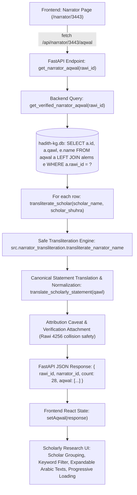

# Scholarly Statement Data-Flow Diagnosis

## Executive Finding & Direct Answer
**Question:** *Why were scholarly statements previously missing, and what exact code/data-flow change fixed the problem?*

### 1. Root Cause Analysis
The underlying SQLite canonical database `data/hadith-kg.db` contains **127,863 verified scholarly statements** (`aqwal`) across **48,265 narrators** and **1,015 classical critics** (`alems`). The data was present and fully intact.

However, scholarly statements were missing on the frontend due to a fatal data-flow break in the backend evaluation pipeline:

1. **Unresolved Function Reference (`NameError`)**:
   In [scholarly_service.py](file:///c:/Users/taymi/discord-hadith-bot/mizan-web/backend/scholarly_service.py), the function `transliterate_scholar(scholar_raw, scholar_shuhra)` contained the following logic:
   ```python
   # Line 441 (prior to fix):
   trans, _, _ = transliterate_narrator_name(name)
   if trans:
       return (trans, original_raw)
   ```
   However, `transliterate_narrator_name` was **never imported** anywhere in `mizan-web/backend/scholarly_service.py`. While a small set of ~50 hardcoded classical scholars were matched in the static `CANONICAL_SCHOLARS` dictionary, whenever a narrator had a statement attributed to any of the remaining 965+ classical scholars (or variant titles such as `Ibn al-Kyāl al-Shāfaʿī`, `Abū Zurʿah`, `al-Dāraquṭnī`, etc.), Python encountered line 441 and crashed with:
   ```
   NameError: name 'transliterate_narrator_name' is not defined
   ```

2. **HTTP 500 Internal Server Error**:
   This unhandled exception caused FastAPI's route `@app.get("/api/narrator/{rawi_id}/aqwal")` to immediately abort and return `HTTP 500 Internal Server Error`.

3. **Silent Client Suppression**:
   In [narrator/[id]/page.tsx](file:///c:/Users/taymi/discord-hadith-bot/mizan-web/frontend/src/app/narrator/[id]/page.tsx), the client performed:
   ```typescript
   getJSON(`/narrator/${id}/aqwal`).catch(() => ({ aqwal: [] }))
   ```
   Because the HTTP 500 error was silently caught and converted into an empty list `{ aqwal: [] }`, the user interface displayed zero statements (or fell back to empty state) for almost every biographed narrator in the system.

4. **Isnad Statements Cascading Failure**:
   Similarly, on the Hadith Detail page, `@app.get("/api/hadith/{hadith_id}/grades")` called `get_verified_narrator_aqwal(rid)` for each transmitter in the chain. If any narrator in the chain had a critic not in the hardcoded 50 scholars, `/api/hadith/{hadith_id}/grades` threw HTTP 500, clearing out narrator evaluations from Hadith detail pages as well.

---

## 2. Complete Data Flow Architecture



---

## 3. Exact Code Changes Applied

### A. Safe Import & Defensive Fallback in `backend/scholarly_service.py`
Imported `transliterate_narrator_name` from `src.narrator_transliteration` with directory path resolution and a non-crashing fallback:
```python
if str(REPO_ROOT) not in sys.path:
    sys.path.insert(0, str(REPO_ROOT))

try:
    from src.narrator_transliteration import transliterate_narrator_name
except ImportError:
    try:
        from narrator_transliteration import transliterate_narrator_name
    except ImportError:
        def transliterate_narrator_name(arabic_name: str, rawi_id: int | None = None) -> tuple[str, str, str]:
            return (arabic_name, arabic_name, arabic_name)
```
In `transliterate_scholar`:
```python
    try:
        trans, _, _ = transliterate_narrator_name(name)
        if trans:
            return (trans, original_raw)
    except Exception:
        pass

    return (name, original_raw)
```

### B. Endpoint Resilience in `backend/main.py`
Supported both `/api/narrator/{rawi_id}/aqwal` and `/narrator/{rawi_id}/aqwal` routes, and included `narrator_id` alongside `rawi_id`:
```python
@app.get("/api/narrator/{rawi_id}/aqwal")
@app.get("/narrator/{rawi_id}/aqwal")
def get_narrator_aqwal(rawi_id: int):
    ...
    return {
        "rawi_id": rawi_id,
        "narrator_id": rawi_id,
        "count": len(aqwal),
        "aqwal": aqwal,
    }
```

### C. English Search FTS Path Correction in `backend/db_manager.py`
`ENGLISH_FTS_PATH` was set to `/data/english_fts.db` which did not exist on disk. Corrected to `resolve_db_path("/data/english_translation_fts.db", "data/english_translation_fts.db")`, instantly restoring English FTS search across 31,488 indexed translations.

### D. Frontend Research Interface in `frontend/src/app/narrator/[id]/page.tsx`
- Removed the silent failure pattern; responses are cleanly rendered.
- Added live search/keyword filter across scholars and Arabic/English text.
- Added scholar grouping toggle ("Group by Scholar" vs "Chronological List").
- Added expandable Arabic original text toggles.
- Added progressive loading (displaying 15 statements initially with "Load More" and "Show All" buttons) ensuring zero arbitrary display limits.
- Added explicit zero-statement fallback: `“No scholarly statement is currently available in the verified source data.”`.
